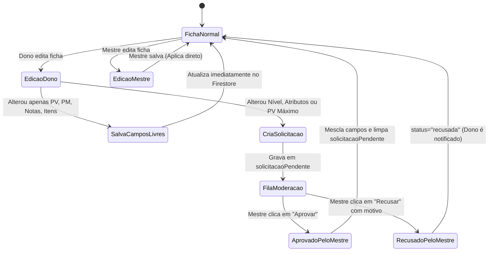

# Modelo de Dados & Segurança do Firestore — Hub Tormenta 20

Este documento detalha o schema do banco de dados Cloud Firestore, os contratos de tipos, o ciclo de vida da moderação de personagens e as regras de segurança aplicadas em produção.

---

## 1. Coleções & Documentos

### 1.1. Coleção `configuracoes`
Armazena parâmetros operacionais e o estado dinâmico da mesa.

#### Documento: `configuracoes/campanha`
```typescript
export type StatusSessao = "Confirmada" | "Em Votação" | "Cancelada";

export interface DadosCampanha {
  proximaSessao: {
    titulo: string;           // Ex: "Sessão 12 - A Batalha de Yuvalin"
    data: string;             // Data formatada (ex: "Sábado, 07 de Novembro - 19:30h")
    status: StatusSessao;     // Controla a cor do badge na Home
    dtTesteFoundry: number;   // Dificuldade da rolagem de d20 para liberar o Foundry (ex: 15)
  };
  ultimaSessao: {
    numero: number;           // Ex: 11
    titulo: string;           // Ex: "Teias de Sombras e Ouro"
    resumo: string;           // Breve sinopse diegética do que aconteceu
    linkWiki: string;         // Link relativo para a nota na wiki (ex: "/wikitormenta?slug=...")
  };
  servidor: {
    foundryUrl: string;       // URL dinâmica do Foundry VTT (ex: "http://rpgtormenta.servegame.com:30000")
  };
}
```

---

### 1.2. Coleção `usuarios`
Registra cada aventureiro autenticado via Google Provider.

#### Documento: `usuarios/{uid_do_usuario}`
```typescript
export type RoleUsuario = "mestre" | "jogador";

export interface DadosUsuario {
  uid: string;                // UID vindo do Firebase Auth
  nome: string;               // Nome de exibição da conta Google
  email: string;              // Email da conta Google
  fotoUrl?: string;           // Avatar da conta Google
  role: RoleUsuario;          // "mestre" (privilégios totais) ou "jogador"
  personagemId?: string | null;// ID da ficha principal vinculada na vitrine
}
```

---

### 1.3. Coleção `personagens`
Armazena a ficha imersiva completa de cada herói da campanha.

#### Documento: `personagens/{id_do_personagem}`
O documento é dividido conceitualmente em:
1. **Campos Livres:** Podem ser editados a qualquer momento pelo dono da ficha (sem aprovação prévia).
2. **Campos Protegidos:** Alterações solicitadas por um jogador comum entram na fila de moderação do Mestre.
3. **Fila de Moderação:** Objeto `solicitacaoPendente` contendo as alterações aguardando julgamento.

```typescript
export interface PersonagemRPG {
  id: string;
  donoUid?: string | null;     // UID do jogador associado (ou null se for NPC/desvinculado)
  donoNome?: string | null;    // Nome do jogador em cache para a vitrine
  criadoEm?: string;
  atualizadoEm?: string;

  // --- Campos Livres (Dono ou Mestre editam diretamente) ---
  pvAtual: number;             // Vida atual
  pmAtual: number;             // Mana atual
  avatarUrl: string;           // URL direta da imagem do herói
  descricao: string;           // Biografia, histórico e crônica pública
  anotacoes: string;           // Diário secreto (visível apenas para Dono e Mestre)
  pericias?: ItemPericia[];    // Perícias e treinos
  poderes?: ItemPoder[];       // Habilidades e poderes
  magias?: ItemMagiaPersonagem[];// Grimório arcano e divino
  equipamentos?: ItemEquipamento[];// Mochila, armas, armaduras e moedas
  moedas?: {
    tl: number;                // Tibar de Platina (1 TL = 10 TO)
    to: number;                // Tibar de Ouro (T$)
    tp: number;                // Tibar de Prata (10 TP = 1 TO)
    tc: number;                // Tibar de Cobre (100 TC = 1 TO)
  };

  // --- Campos Protegidos (Regras de Tormenta 20 / Balanço de Mesa) ---
  nome: string;
  raca: string;
  classe: string;
  origem: string;
  nivel: number;
  divindade: string;
  pvMaximo: number;
  pmMaximo: number;
  defesa: number;
  atributos?: {
    for: number;
    des: number;
    con: number;
    int: number;
    sab: number;
    car: number;
  };

  // --- Fila de Moderação do Mestre ---
  solicitacaoPendente?: {
    status: "pendente" | "recusada";
    solicitadoEm: string;      // Timestamp ISO
    motivoRecusa?: string;     // Justificativa do Mestre caso recusado
    campos: Partial<PersonagemRPG>; // Contém apenas os campos protegidos alterados
  } | null;
}
```

---

## 2. Ciclo de Vida da Moderação de Ficha



---

## 3. Prevenção de Erros de Serialização (`undefined`)

> [!IMPORTANT]
> O SDK do Firebase Firestore lança uma exceção fatal (`FirebaseError: Function updateDoc() called with invalid data. Unsupported field value: undefined`) caso qualquer objeto ou elemento de array contenha propriedades com valor `undefined`.

Para blindar todas as operações de persistência, todos os formulários e conversores utilizam a serialização segura nativa antes do `updateDoc`:

```typescript
const payloadLimpo = JSON.parse(
  JSON.stringify({
    equipamentos: itens,
    moedas,
    atualizadoEm: new Date().toISOString(),
  })
);
await updateDoc(refDoc, payloadLimpo);
```

Isso garante que campos opcionais ausentes (como dano em armaduras ou penalidade em anéis) sejam omitidos do payload em conformidade com as regras do Firestore.

---

## 4. Regras de Segurança (`firestore.rules`)

As regras em produção em `firestore.rules` (na raiz e em `portal/`) garantem controle rigoroso de acesso:

```javascript
rules_version = '2';
service cloud.firestore {
  match /databases/{database}/documents {

    // Função de checagem do cargo de Mestre no documento do usuário
    function ehMestre() {
      return request.auth != null &&
        exists(/databases/$(database)/documents/usuarios/$(request.auth.uid)) &&
        get(/databases/$(database)/documents/usuarios/$(request.auth.uid)).data.role == "mestre";
    }

    // 1. Configurações da Campanha
    // Leitura: pública para alimentar a Landing Page e widgets
    // Escrita: restrita exclusivamente ao Mestre
    match /configuracoes/{documento} {
      allow read: if true;
      allow write: if ehMestre();
    }

    // 2. Coleção de Usuários (Prevenção contra escalação de privilégios)
    match /usuarios/{userId} {
      // Leitura: o próprio usuário ou o Mestre
      allow read: if request.auth != null && (request.auth.uid == userId || ehMestre());

      // Criação: o próprio usuário, mas a role DEVE ser "jogador"
      allow create: if request.auth != null 
        && request.auth.uid == userId 
        && request.resource.data.role == "jogador";

      // Atualização:
      // - O Mestre pode atualizar tudo (inclusive promover cargos).
      // - O jogador só atualiza o seu próprio registro e NÃO pode alterar sua role.
      allow update: if request.auth != null && (
        ehMestre() || 
        (
          request.auth.uid == userId && 
          request.resource.data.role == resource.data.role
        )
      );
    }

    // 3. Fichas de Personagens
    // Leitura: pública para a Vitrine de Heróis
    // Escrita: restrita ao dono da ficha ou ao Mestre
    match /personagens/{personagemId} {
      allow read: if true;
      allow write: if request.auth != null && (
        ehMestre() || 
        (resource != null && resource.data.donoUid == request.auth.uid) ||
        (resource == null && request.resource.data.donoUid == request.auth.uid)
      );
    }
  }
}
```

