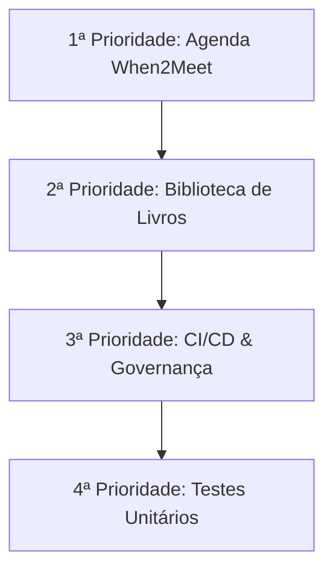

# Roadmap & Backlog — Hub Tormenta 20

Este documento descreve o planejamento das próximas funcionalidades e melhorias técnicas priorizadas para o portal.

---

## 1. Prioridades de Desenvolvimento



---

### 1ª Prioridade: Agenda Estilo *When2Meet* (Próxima Sessão)

* **Objetivo:** Facilitar a marcação de sessões da mesa através de uma grade matricial interativa de datas e horários disponíveis.
* **Diferencial Temático:** Em vez de exibir apenas o nome do jogador, as células selecionadas exibirão o avatar e nome do herói vinculado.
* **Arquitetura Prevista:**
  - **Rota:** `/agenda`.
  - **Coleção no Firestore:** `agendamentos/{agendamentoId}`.
  - **Subcoleção:** `agendamentos/{agendamentoId}/votos/{uidUsuario}` com a lista de slots marcados.
  - **Heatmap Visual:** Células variam em intensidade de cor (pedra $\rightarrow$ âmbar $\rightarrow$ esmeralda) conforme a quantidade de aventureiros confirmados naquele horário.
  - **Ação do Mestre:** Botão de "Bater o Martelo", que encerra a votação e atualiza instantaneamente o documento `configuracoes/campanha` com a data e horário definidos, refletindo na Home.

---

### 2ª Prioridade: Biblioteca de Livros & Suplementos (Google Drive)

* **Objetivo:** Disponibilizar o acesso rápido e seguro aos manuais e suplementos da mesa (Tormenta 20 Jogo do Ano, Ameaças de Arton, Atlas de Arton, Guia de NPCs, fichas de apoio).
* **Arquitetura Prevista:**
  - **Rota:** `/livros`.
  - **Armazenamento:** Google Drive compartilhado com pastas organizadas por categoria (Regras, Cenário, Aventuras).
  - **Visualizador:** Leitor embutido com iframe seguro ou visualizador PDF responsivo.
  - **Permissões:** Acesso liberado para jogadores autenticados da mesa.

---

### 3ª Prioridade: CI/CD & Deploy Automático das Regras do Firebase

* **Objetivo:** Eliminar a necessidade de publicar manualmente as regras de segurança no console do Firebase.
* **Arquitetura Prevista:**
  - **GitHub Actions:** Workflow acionado em commits na branch `main` que tocarem em `firestore.rules`.
  - **Action Oficial:** `w9jds/firebase-action` com token de serviço de deploy (`FIREBASE_TOKEN`).
  - **Validação Prévia:** `firebase-tools` executando `firebase firestore:rules:stage` para validar sintaxe antes de aplicar em produção.

---

### 4ª Prioridade: Suíte de Testes Unitários

* **Objetivo:** Garantir que cálculos de regras de Tormenta 20 e conversores de compêndio permaneçam estáveis a cada alteração.
* **Escopo dos Testes:**
  - Cálculo de perícias de T20 (treino + metade do nível + modificador de atributo).
  - Conversores de dados do Foundry (`FormatadorPoderesT20`, `FormatadorEquipamentosT20`, `FormatadorMagiasT20`).
  - Sanitizador de payloads do Firestore (garantir zero valores `undefined`).
  - Framework recomendado: **Vitest** (rápido e nativamente integrado ao TypeScript/Turbopack).

---

## 2. Melhorias Técnicas & Otimizações de Performance

### 1. Ingestão Estática dos JSONs no Bundle Inicial (Code-Splitting Sob Demanda)

#### O Problema:
Atualmente, os arquivos de dados do compêndio (`poderes.json` com 646 poderes, `magias.json` com 200 magias e `equipamentos.json` com 211 itens) somam alguns megabytes e são importados de forma síncrona no topo de suas respectivas abas (`import compendio... from '@/dados/...'`).

Como resultado:
- Sempre que um usuário acessa a rota `/personagens/[id]`, o navegador é obrigado a baixar e fazer parse de todo o catálogo de mais de 1.000 itens logo no carregamento inicial da página.
- Isso ocorre mesmo que o jogador vá apenas ler anotações rápidas ou consultar PV/PM, sem jamais abrir os modais de compêndio.
- Conforme novos suplementos forem adicionados (ex: *Ameaças de Arton*, *Atlas de Arton*, *Guia de NPCs*), o bundle JavaScript crescerá, degradando o tempo de carregamento inicial (*First Load JS*) e aumentando o consumo de dados móveis.

#### A Solução Arquitetural:
Adotar **Lazy Loading / Code-Splitting Dinâmico** via `dynamic import()` do JavaScript:

1. **Carregamento Just-in-Time:** O estado inicial dos catálogos começa como `null` ou array vazio (`[]`), com uma flag booleana de carregamento (`carregandoCompendio`).
2. **Disparo no Clique do Modal:** A importação do arquivo JSON só é disparada no momento em que o usuário clica no botão *"Aprender Magia"*, *"Adicionar Poder"* ou *"Abrir Compêndio"*:
   ```typescript
   const abrirModalCompendio = async () => {
     setModalAberto(true);
     if (catalogo.length === 0) {
       setCarregando(true);
       const modulo = await import("@/dados/equipamentos.json");
       const dadosNormalizados = modulo.items.map(converterItemFoundryParaEquipamento);
       setCatalogo(dadosNormalizados);
       setCarregando(false);
     }
   };
   ```
3. **Benefícios Imediatos:**
   - **Redução de até ~70% no peso do bundle inicial da ficha.**
   - O carregamento da página do personagem fica instantâneo.
   - O compêndio é baixado em segundo plano e cacheado em memória para aberturas subsequentes.
   - Escalabilidade ilimitada: no futuro, centenas de novos monstros e itens poderão ser adicionados aos dados sem impactar a navegação geral da ficha.
